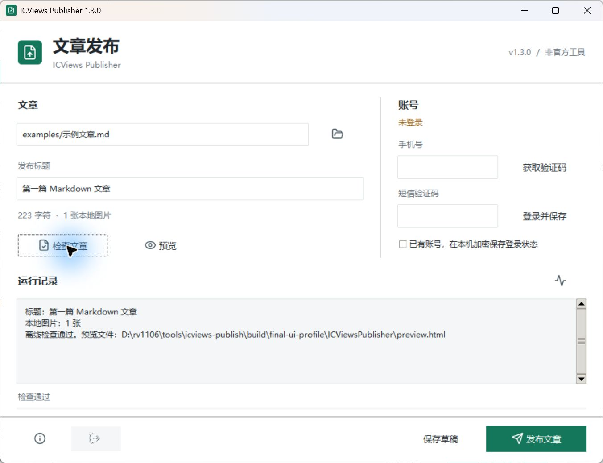

# icviews-publisher

ICViews 发文助手 | Windows 10 / 11 x64 | [MIT](LICENSE)

Windows 原生 Markdown 发文工具，支持本地图片上传、HTML 转换、草稿和公开发布。使用网站现有接口，不打开浏览器填写表单，不包含内置账号。非 ICViews 官方产品。

## 下载与使用

从 [GitHub Releases](https://github.com/318973613/icviews-publisher/releases/latest) 下载 `ICViewsPublisher-1.3.0-windows-x64.zip`，不用安装 Python，也不需要管理员权限。

1. 完整解压后运行 `ICViewsPublisher.exe`，不要只复制单独的 EXE。
2. 选择 Markdown 文章，检查标题和图片，按需预览。
3. 登录自己的已有 ICViews 账号，保存草稿或确认公开发布。

详细说明见 [使用说明.txt](使用说明.txt)。转发给别人时发送原始 ZIP 即可。

首次启动不选择任何文章、不携带账号。每个人登录自己的账号；登录态由 Windows DPAPI 加密，存储在 `%LOCALAPPDATA%/ICViewsPublisher`，不在程序目录中。



## 从源码运行

```powershell
python -m venv .venv
./.venv/Scripts/python.exe -m pip install -r requirements.txt
./.venv/Scripts/python.exe entry.py
./.venv/Scripts/python.exe entry.py "path/to/article.md"
```

命令行用法：

```powershell
./.venv/Scripts/python.exe publish.py check "path/to/article.md"
./.venv/Scripts/python.exe publish.py doctor
./.venv/Scripts/python.exe publish.py auth
./.venv/Scripts/python.exe publish.py topics
./.venv/Scripts/python.exe publish.py upload "path/to/article.md"
./.venv/Scripts/python.exe publish.py draft "path/to/article.md"
./.venv/Scripts/python.exe publish.py publish "path/to/article.md" --yes
./.venv/Scripts/python.exe publish.py logout
```

`auth` 是手动输入已有 Session 的备用方式。普通用户使用图形窗口短信登录即可，不要把凭据贴到聊天或命令行参数里。

可选参数：`--title` 覆盖发布标题，重复 `--topic ID` 添加现有话题，`--replace-draft` 明确允许覆盖网站草稿，`--import-map FILE` 显式信任旧路径到 URL 的映射。导入旧映射前需要确认原文件未修改。

## 构建分享包

在 Windows x64 和 Python 3.13 下构建：

```powershell
./.venv/Scripts/python.exe -m pip install -r build-requirements.txt
./.venv/Scripts/python.exe build_release.py
```

构建使用已随源码保存的 Lucide SVG 生成 PNG/ICO，然后用 PyInstaller 构建界面与隐藏运行的工作进程，二者共享 `_internal` 运行库。构建不读取用户状态目录，源码包采用白名单，不收集 `.venv`、缓存、凭据或私人文章。

输出 Windows 便携包、源码包、SHA-256 清单、构建清单和第三方许可证。程序未签名，不使用 UPX，不创建计划任务或注册表启动项。请勿关闭杀毒软件来构建或运行。

## 验证

```powershell
./.venv/Scripts/python.exe -m unittest discover -s . -p "test_*.py" -v
```

测试覆盖 Markdown 和本地图片解析、上传断点恢复、HTTP 错误脱敏、短信登录协议、DPAPI、重复提交保护，以及源码/冻结程序工作进程路径。构建会在独立用户状态目录和移动后的目录中验证冻结工作进程，不发送短信或文章。

## 接口与限制

基于网站公开前端接口：`/back/icviews/web/sendSmsCode`、`smsLogin`、`/back/icviews/common/file/upload/image` 及 `/back/icviews/wx/semi/draft`、`posts`。不是稳定承诺的官方 SDK，接口变动可能需要更新。

不支持更新已发表文章。提交前先落地记录，结果不确定时停止而非自动重试。同账号、同路径的成功或不确定提交会拦截后续同类提交；更改文件路径不是重试方法。原生 HTML 被转义；本地图片必须在文章目录内，远程图片不重新托管。

## 反馈与贡献

欢迎通过 [Issues](https://github.com/318973613/icviews-publisher/issues) 反馈问题，或提交 Pull Request。请附上版本、Windows 版本、复现步骤和脱敏错误信息，不要上传手机号、验证码、Session、状态目录或私人文章。

修改后请运行上面的测试。涉及网站接口时优先补充模拟响应测试，不要在自动化测试中发送短信或发布真实文章。

## 开源协议

本项目代码采用 [MIT License](LICENSE)。Lucide 图标及打包的第三方运行库保留各自许可证，详见 `assets/LUCIDE-LICENSE.txt` 和发行包中的 `THIRD_PARTY_NOTICES.txt`。
