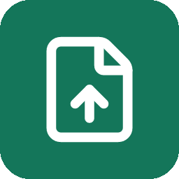

# 第一篇 Markdown 文章

这是一篇用于离线检查和预览的示例，发布前请换成自己的内容。

## 一张本地图片



## 一段代码

```python
print("Hello, ICViews!")
```

## 一个表格

| 项目 | 内容 |
| --- | --- |
| 标题 | 来自 Markdown 的一级标题 |
| 图片 | 与文章放在同一个目录 |

示例到这里结束。
